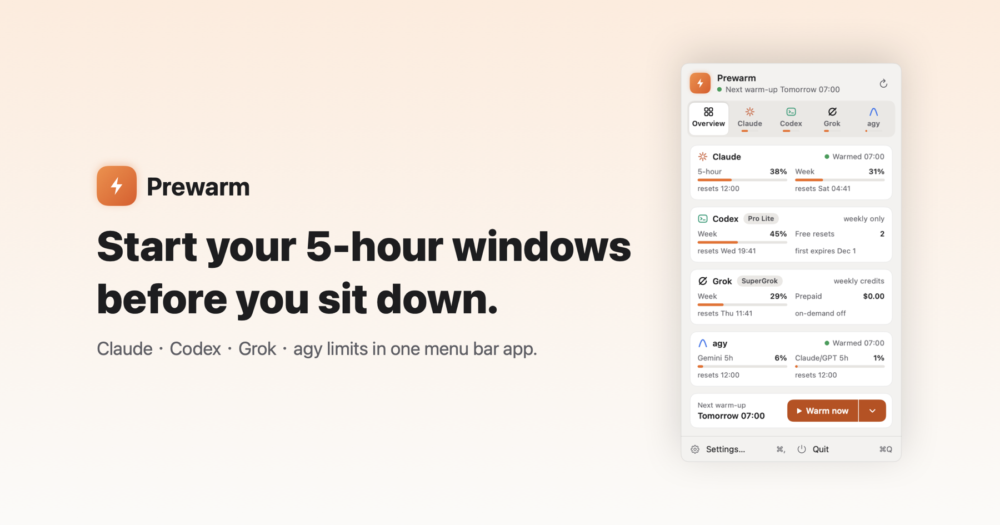
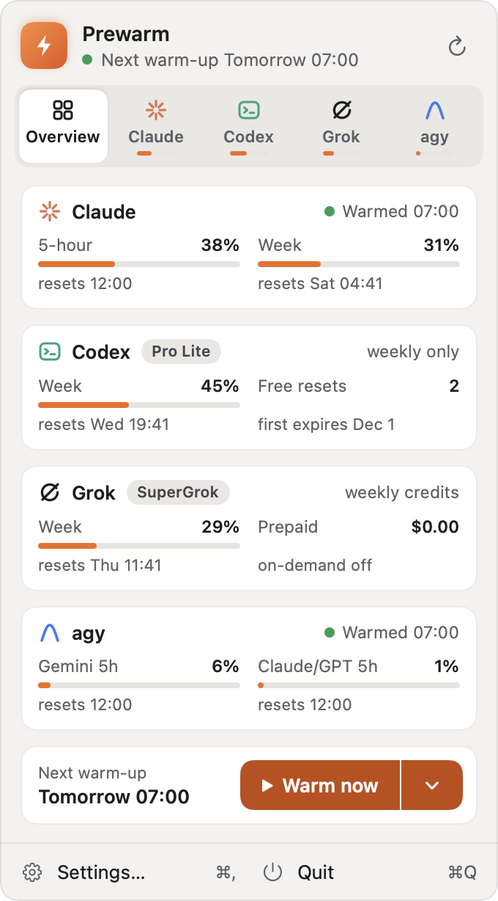
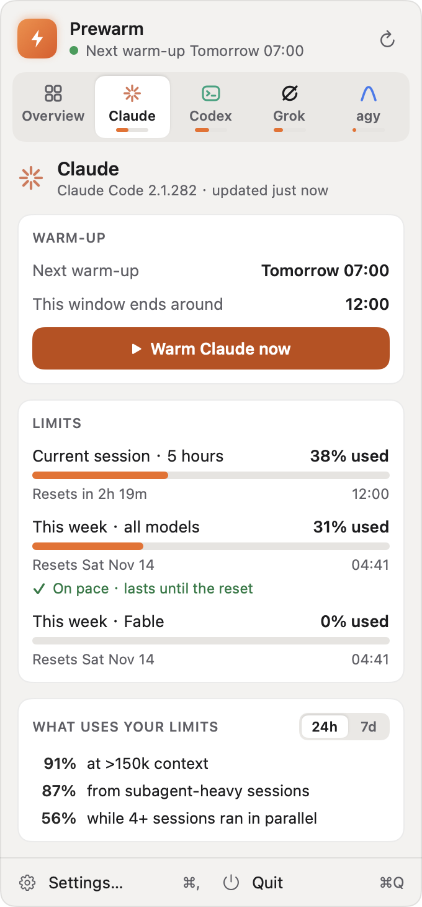
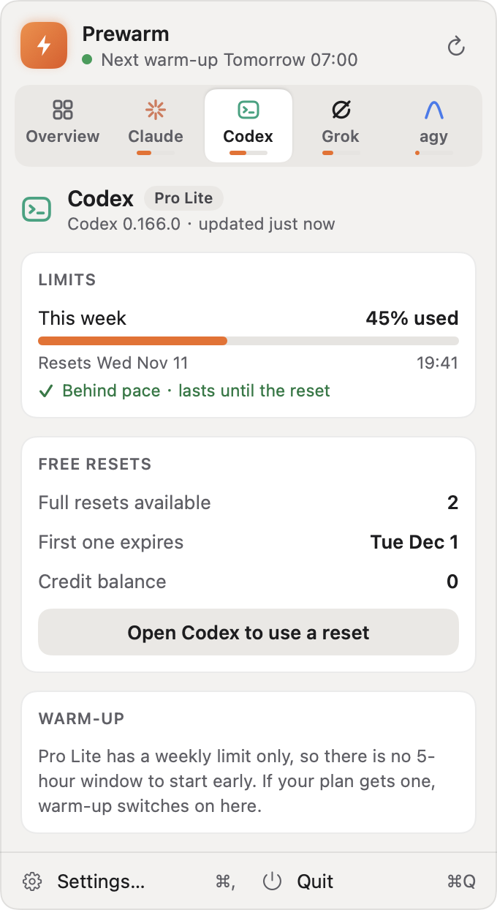
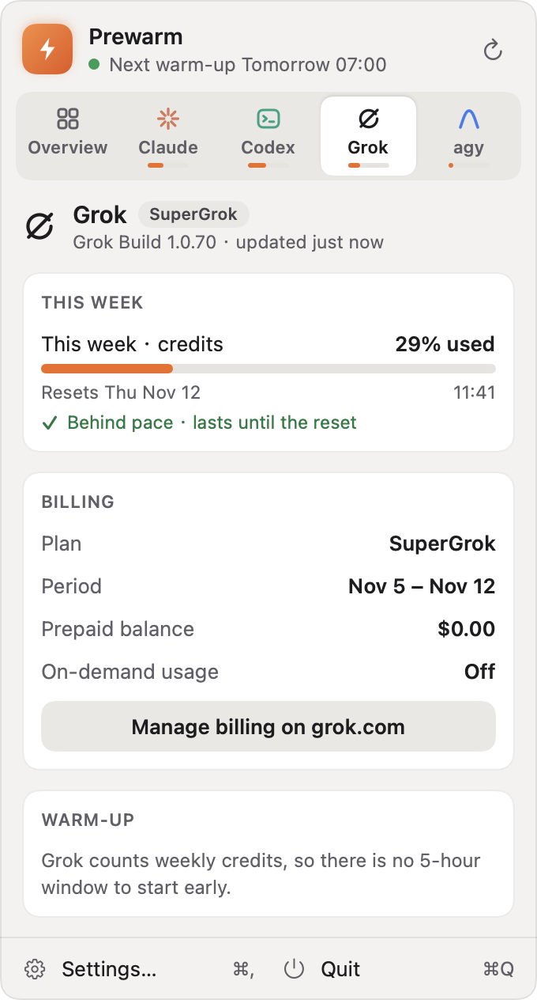
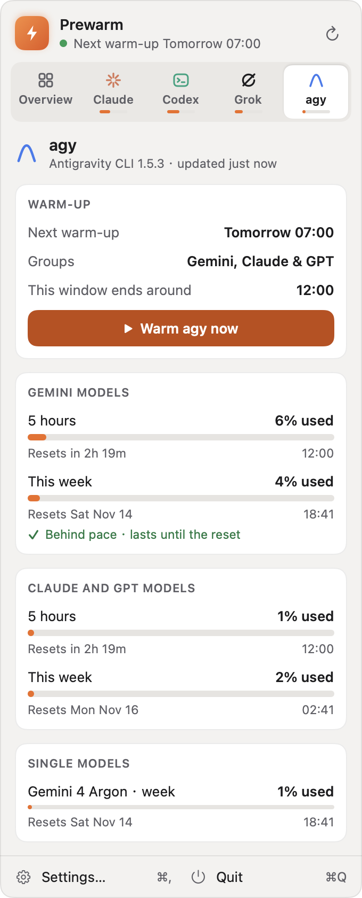
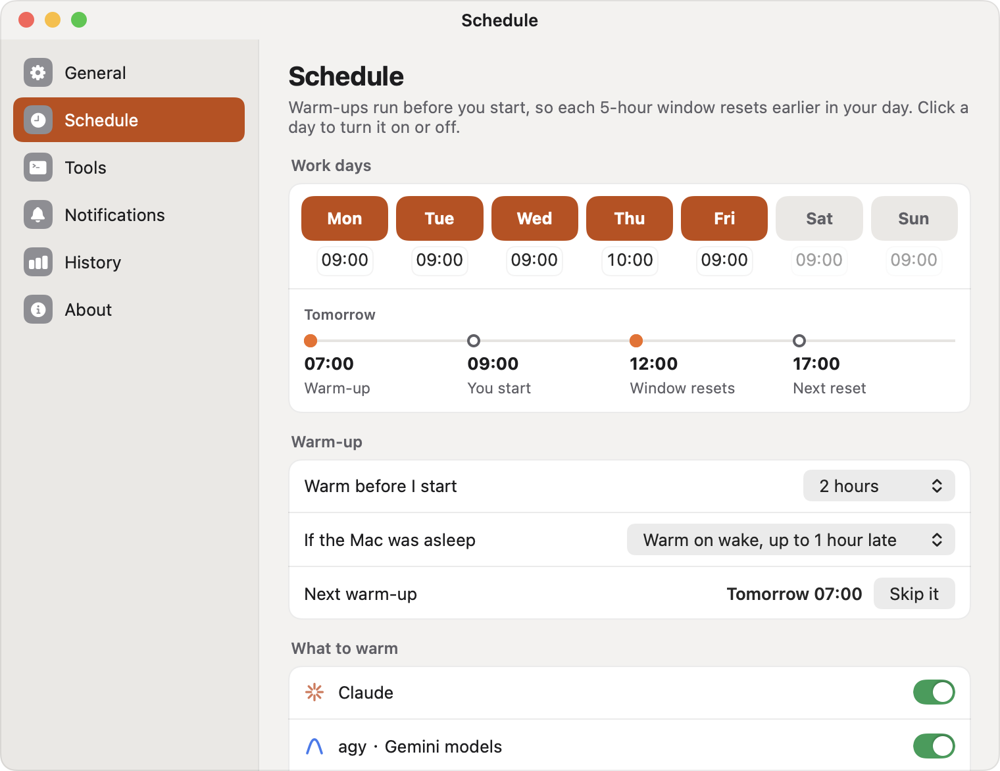
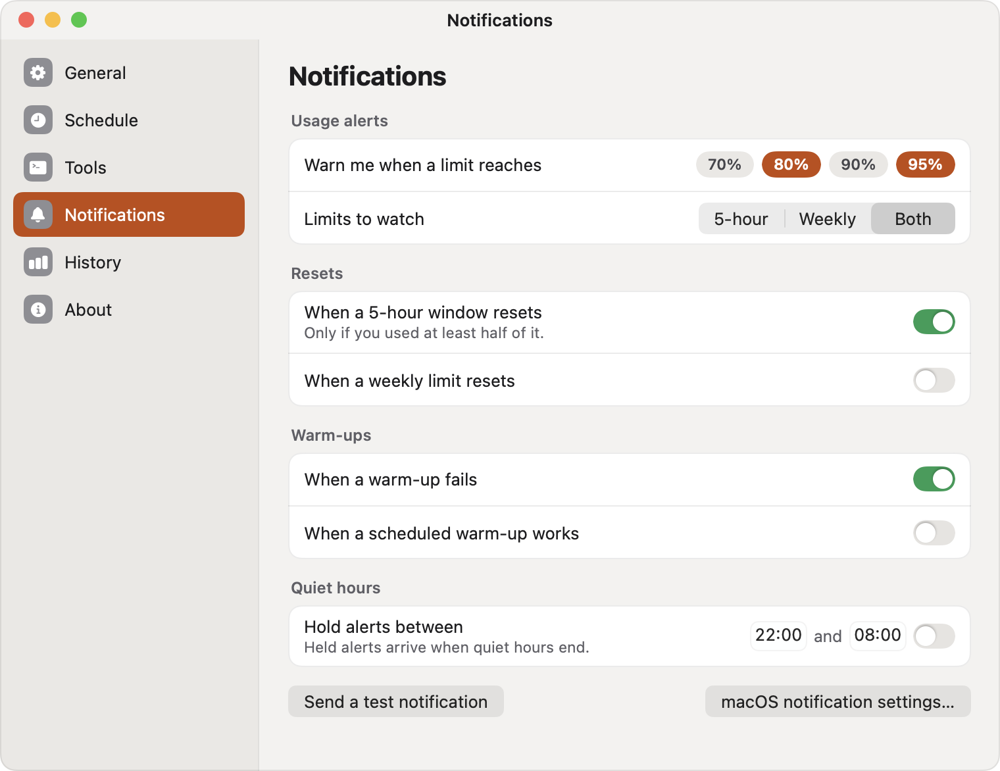

<p align="center">
  
</p>

<h1 align="center">Prewarm</h1>

<p align="center"><i>Formerly Claude Prewarm. It now covers Codex, Grok and agy too.</i></p>

<p align="center">
  A macOS menu bar app that starts your AI coding windows before you sit down,<br>
  and keeps Claude, Codex, Grok and agy limits in one menu.<br>
  <a href="https://github.com/Charonyuu/prewarm/releases/latest"><b>Download for macOS</b></a>
  · <a href="https://apps.app.charonyu.cc/en/prewarm/">Website</a>
  · 100% local · No API keys · No telemetry
</p>

---

## The problem

Claude Code gives you a rolling **5-hour usage window**. The clock starts on your
first request of the day — so if you start work at 09:00, your window runs to 14:00,
and you spend the afternoon waiting for it to reset. agy (the Antigravity CLI), and
Codex on plans that have one, work the same way.

## What this does

Prewarm sends **one tiny request** at a time you choose, before work.

```
Without Prewarm                    With Prewarm
09:00  first request               07:00  app warms for you
14:00  window resets               09:00  you start work
       ↑ mid-afternoon             12:00  window resets
                                          ↑ before lunch
```

Same quota, earlier window. It does **not** give you more usage; it only moves the window.

And because you probably use more than one tool, the menu shows every limit side by side.

## Install

**With Homebrew:**

```bash
brew install --cask Charonyuu/tap/prewarm
```

`brew upgrade` keeps it current from then on.

**Or one command, without Homebrew:**

```bash
curl -fsSL https://raw.githubusercontent.com/Charonyuu/prewarm/main/install.sh | bash
```

**Or by hand:** [download the latest dmg](https://github.com/Charonyuu/prewarm/releases/latest),
drag **Prewarm** into Applications and launch it. Signed and notarized by Apple.

**You need** macOS 14 (Sonoma) or later, and at least one of these, installed and signed in:
[Claude Code](https://docs.claude.com/en/docs/claude-code/setup),
[Codex](https://developers.openai.com/codex/cli),
[Grok Build](https://x.ai/cli) or
[agy](https://antigravity.google/docs). Tools you don't have can be hidden.

## Using it

Click the bolt in your menu bar (or press **⌥⌘P**). Right-click it for Warm now,
Refresh, and Skip tomorrow's warm-up.

| Overview | Claude |
|---|---|
|  |  |

**Overview** puts every tool's 5-hour and weekly numbers in one place. Each tab
also carries a tiny meter, so you can see who is close to the limit without switching.

| Codex | Grok | agy |
|---|---|---|
|  |  |  |

| Tool | What you see | Warm-up |
|---|---|---|
| Claude | 5-hour session, weekly limit, per-model weekly limits, and what is using your limits (long context, subagents, parallel sessions) | Yes |
| Codex | 5-hour and weekly limits as your plan has them, free resets left and when they expire, credits | When your plan has a 5-hour window |
| Grok | Weekly credits used, billing period, prepaid balance | No (weekly credits only) |
| agy | 5-hour and weekly limits for Gemini models and for Claude & GPT models, plus single-model limits | Yes, each group separately |

Weekly limits get a **pace** line: whether, at your current rate, the limit lasts
until it resets — and if not, roughly when it runs out.

### Settings

| Schedule | Notifications |
|---|---|
|  |  |

- **Schedule** — work days with a start time per day, how far ahead to warm
  (30 minutes to 4 hours), what to do if the Mac was asleep, and which tools to warm.
- **Notifications** — alerts at 70/80/90/95%, when a 5-hour window or weekly limit
  resets, when a warm-up fails, and quiet hours that hold alerts until morning.
- **History** — highest use per tool for each of the last 7 days, and every warm-up
  with how long it took. Export as CSV.
- **General** — launch at login, what the menu bar shows (icon, icon and %, or two
  small bars), how often to check, and which tabs to show.
- **Tools** — where each CLI was found, its version, and whether it is signed in.

## Good to know

**What is actually sent?** One request saying `Reply only OK.`, to the smallest
model each tool offers (Haiku for Claude; for agy, a Flash model and GPT-OSS),
in an empty folder so no project files or `CLAUDE.md` are read.

**How are limits read?** Through each CLI you are already signed in to:

```
claude -p "/usage"
codex app-server        → account/rateLimits/read
grok agent stdio        → _x.ai/billing
agy -p "/usage"
```

**Will it warm twice?** No. It skips a tool warmed in the last 10 minutes, and
never back-fills a warm time that already passed.

**What if my Mac was asleep?** A missed warm runs on wake if it is less than an hour
late (adjustable). Later than that, it waits for the next work day.

**Is any of this sent anywhere?** No. Settings and history live in `UserDefaults`
on your Mac. The app talks to nothing except the CLIs installed on your machine.

## Build from source

```bash
git clone https://github.com/Charonyuu/prewarm.git
cd prewarm
./build.sh --install
```

Needs Xcode. The app is a Swift package — `Sources/ClaudePrewarm` holds everything.

```
App/        Entry, AppState, status item and panel, windows, hot key
Models/     Provider, Usage, AppSettings, WarmLog
Services/   ProviderServices (read + warm), UsageParsers, JSONRPCClient,
            BinaryFinder, ProcessRunner, ScheduleService, SettingsStore,
            NotificationService, LoginItemService
Views/      MenuPanelView, ProviderTabs, SettingsView, OnboardingView,
            Components, Glyphs, MenuBarIcon, Theme
Utilities/  DateCalculator, Pace, Clock
Debug/      ScreenshotRenderer, Probe (debug builds only)
```

Checks for the schedule maths, settings migration and every usage parser:

```bash
./Tools/verify.sh
```

A live read of every CLI on this Mac (debug build), optionally warming some:

```bash
swift build && ./.build/debug/ClaudePrewarm --probe
./.build/debug/ClaudePrewarm --probe claude agyGemini
```

The screenshots in this README come from the real views:

```bash
./.build/debug/ClaudePrewarm --render-screenshots docs/
```

## Releasing

```bash
./build.sh --release
```

Then upload the dmg to a GitHub release and bump `version` and `sha256` in
[the cask](https://github.com/Charonyuu/homebrew-tap/blob/main/Casks/prewarm.rb).

Signs with Developer ID under the hardened runtime, builds a dmg, notarizes it and
staples the ticket. Notarization credentials are stored once:

```bash
xcrun notarytool store-credentials "prewarm-notary" \
    --apple-id "<your Apple ID>" \
    --team-id "<your team id>" \
    --password "<app-specific password>"
```

## Licence

MIT. See [LICENSE](LICENSE).

Not affiliated with Anthropic, OpenAI, xAI or Google. Product names belong to their owners.
